# Splunk SOC Lab

## About This Project

For this project I used Splunk Cloud with a Windows VM to practice basic SOC monitoring.

I generated different types of activity on the Windows machine, checked the events in Event Viewer and Sysmon, sent the logs to Splunk, and then made searches and alerts for them.

The main detections I worked on were:

- repeated failed logins
- PowerShell using ExecutionPolicy Bypass
- scheduled task creation
- curl download activity

## Tools

- Splunk Cloud
- Windows 11 VM
- Sysmon
- PowerShell
- Event Viewer
- Splunk HEC

## Detection 1 - Repeated Failed Logins

I created multiple failed login attempts on the Windows VM.

Windows recorded the failed logins as Event ID 4625. I sent the events into Splunk and used an SPL search to count repeated failed attempts.

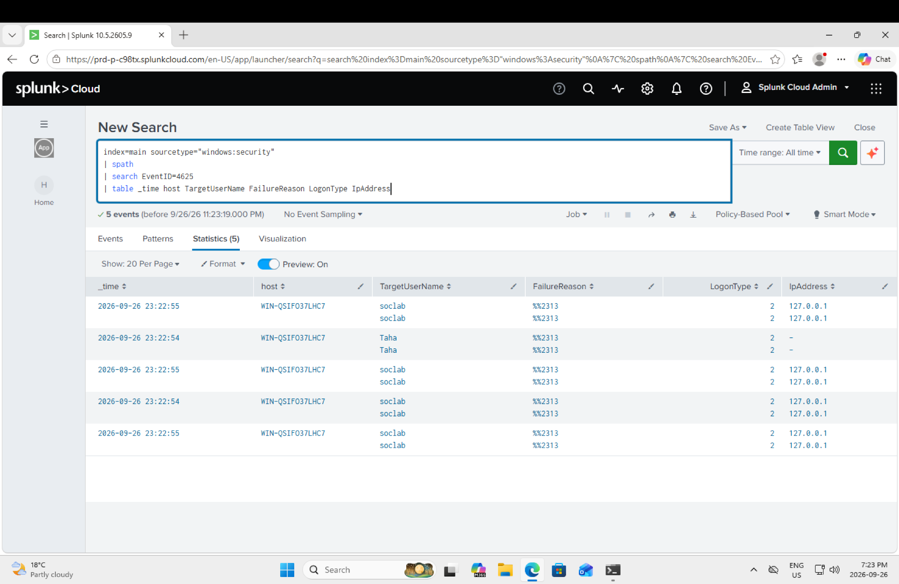

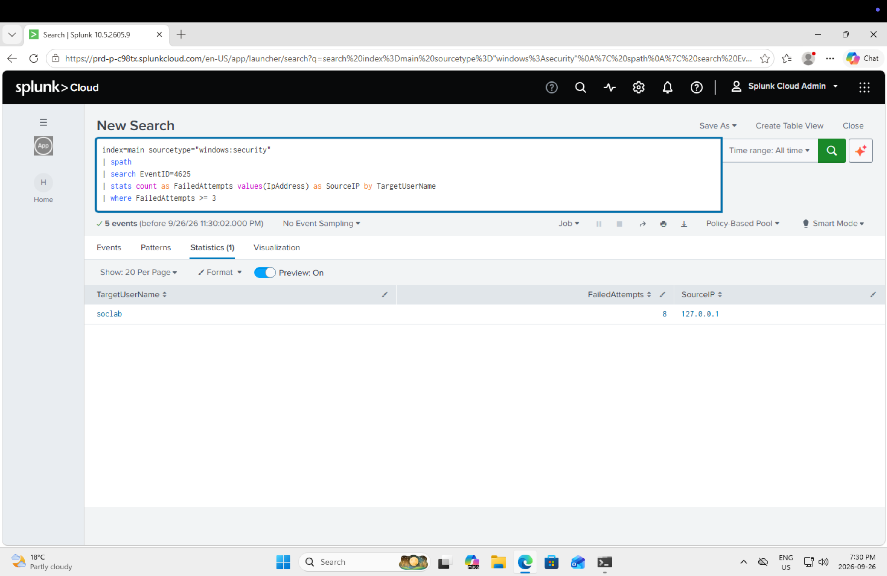

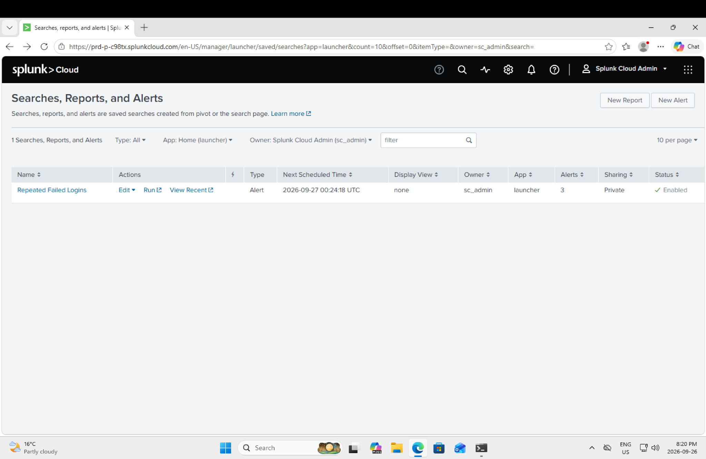

## Detection 2 - PowerShell Execution

For this test I ran PowerShell with `-ExecutionPolicy Bypass`.

Sysmon recorded the process as Event ID 1. I searched for the command in Splunk and created an alert for it.

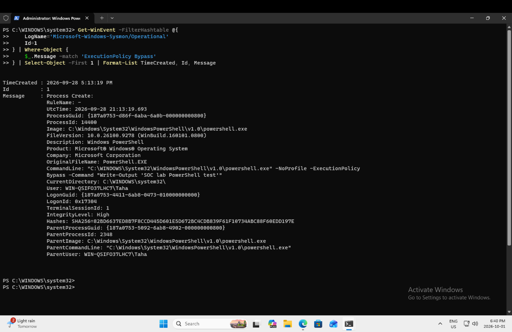

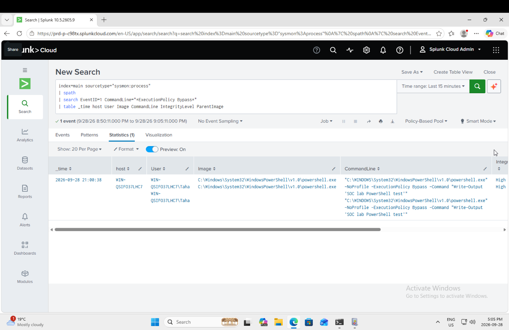

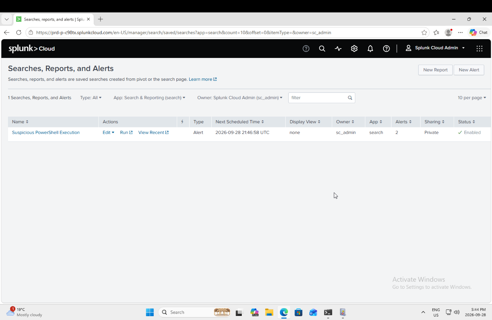

## Detection 3 - Scheduled Task Creation

I created a scheduled task using `schtasks.exe`.

The task was set to run when a user logs in. Sysmon recorded the process and I searched for `schtasks.exe` with `/Create` in Splunk.

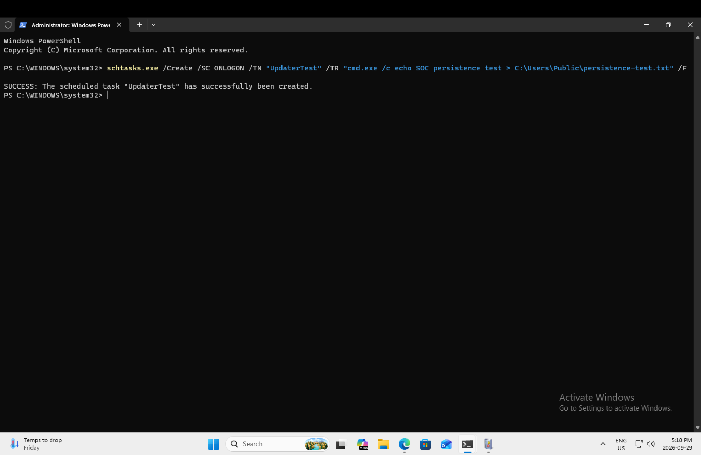

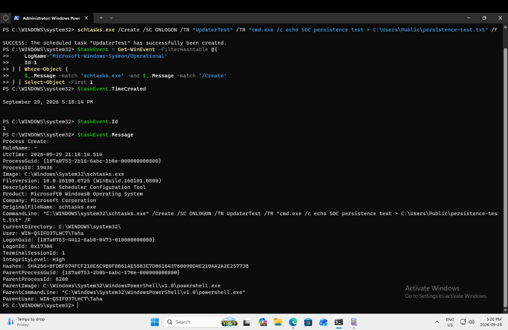

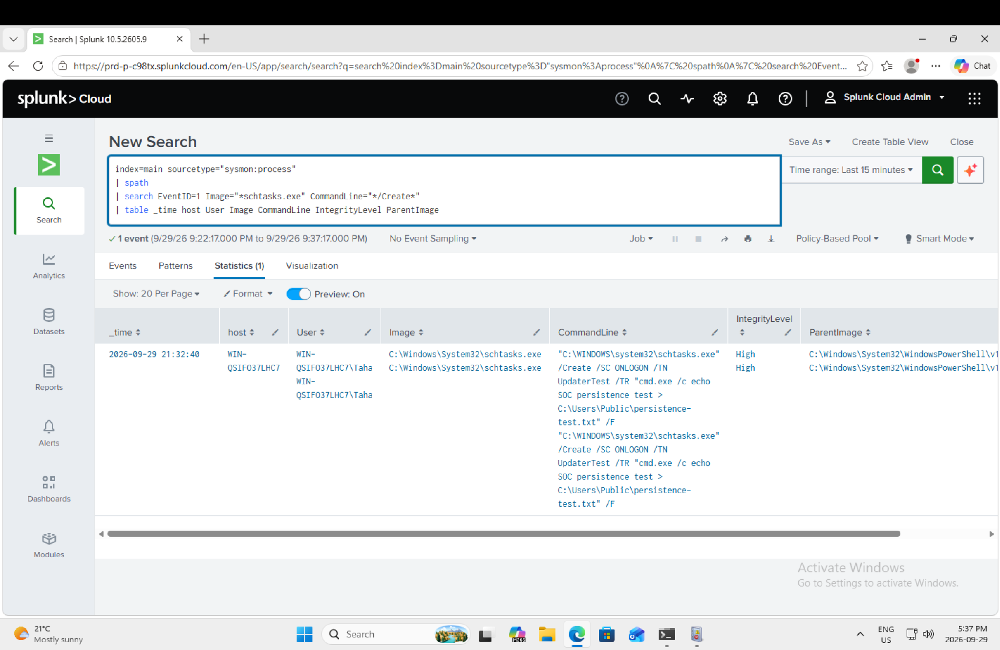

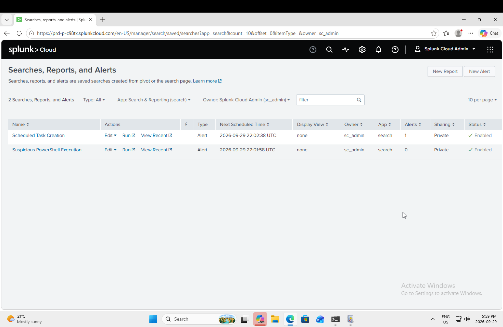

## Detection 4 - Curl Download

For the last detection I used `curl.exe` to download a test page from example.com.

Sysmon recorded the curl process and I used Splunk to search for the command and create an alert.

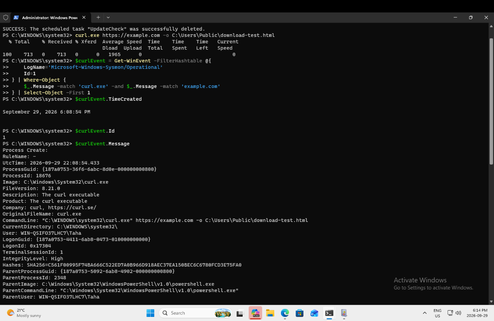

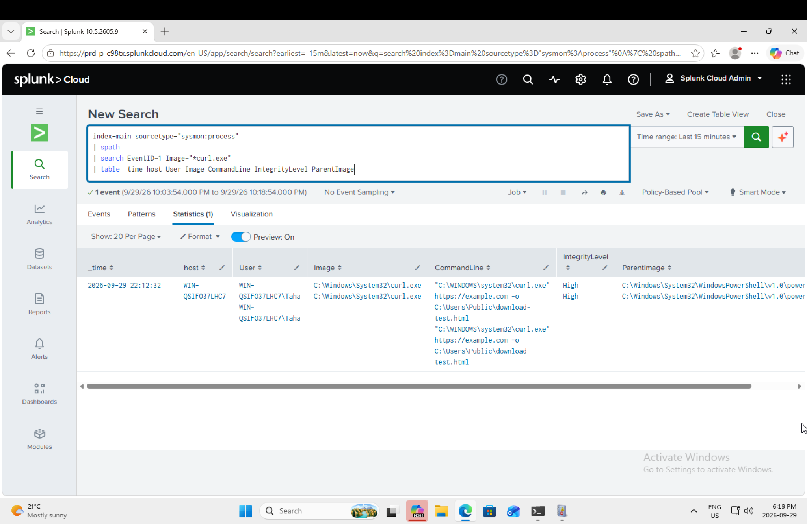

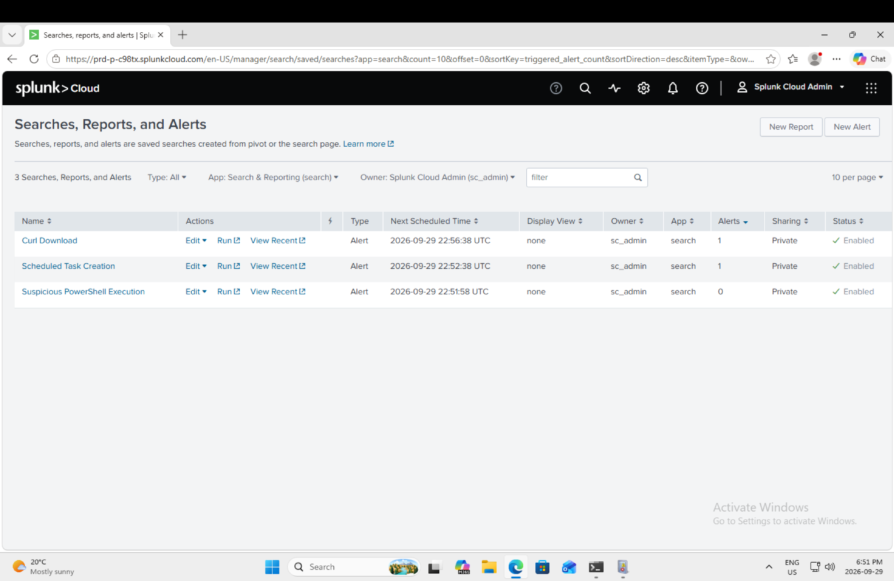

## What I Practiced

This project gave me practice with:

- Windows Security logs
- Sysmon
- Splunk searches
- SPL
- alert creation
- process monitoring
- failed login detection
- basic persistence detection

The SPL searches I used are saved in the `Queries` folder.
